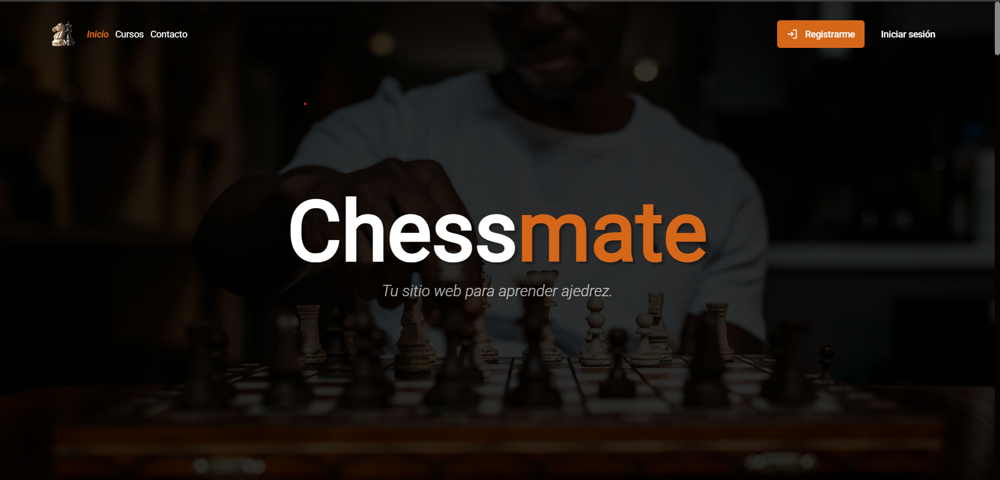
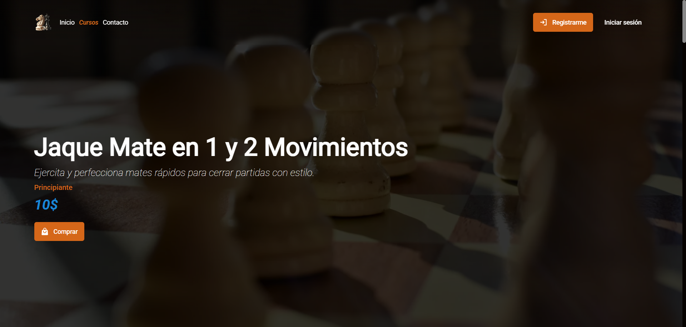
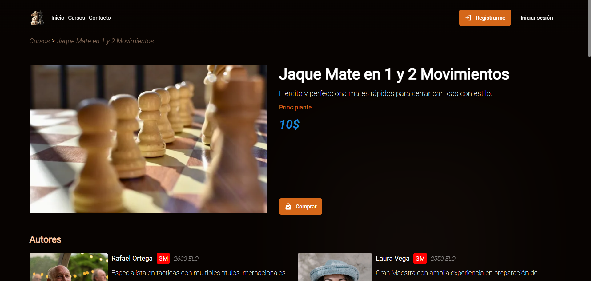
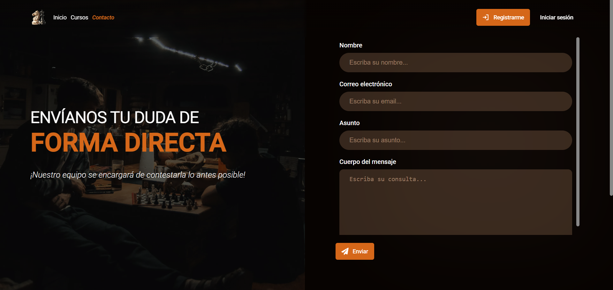
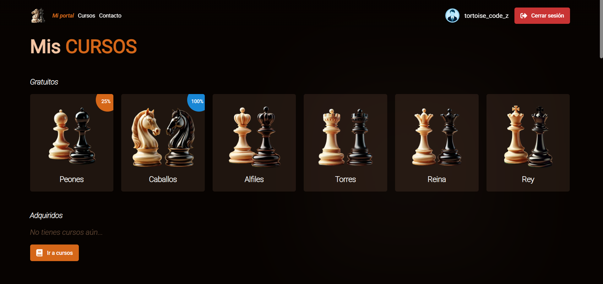
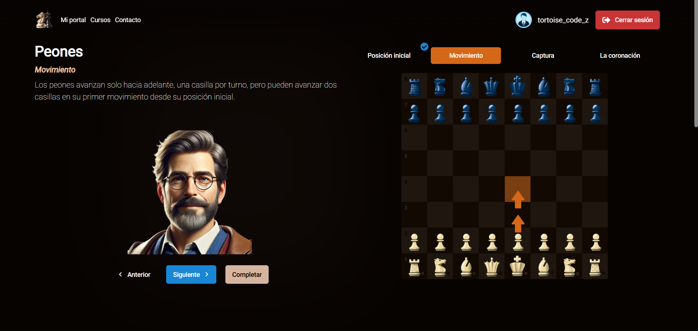
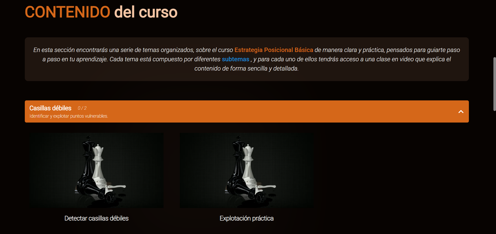
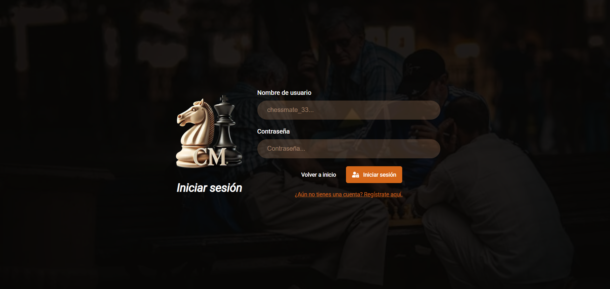

# ♟️ Chessmate: Chess Learning Platform

A **responsive frontend web app** for online chess courses, with a **client-side simulated backend**. I designed the whole interface from scratch in **Figma** and built it with React and TypeScript.
I used **AI as a copilot** during development to brainstorm ideas and work through questions.

With Chessmate, users can:

- Sign up and manage their profile.
- Browse and filter the available courses.
- See full details for each course.
- Buy courses and track their progress in a **personal dashboard** and a **virtual classroom**.



---

## Table of contents 🧭

- [Demo](#demo-)
- [Features](#features-)
- [Installation](#installation-)
- [Usage](#usage-)
- [Challenges and what I learned](#challenges-and-what-i-learned-)
- [Project structure](#project-structure-)
- [Tech stack](#tech-stack-)
- [Licence](#licence-)
- [Contact](#contact-)

---

## Demo 🚀

**Live:** https://tortoise-code-z.github.io/Chessmate-react/

**Demo account:** username `admin` · password `1234` (or register a new user).

<details>
<summary><b>Screenshots</b></summary>











</details>

---

## Features ✨

- **Responsive design** that works well on mobile and desktop.
- **Multilingual (Spanish / English)** with i18next: UI and course content, with the language remembered between visits.
- **Smooth animations** that make interactions feel natural.
- **Form validation** with Zod and React Hook Form.
- **Global state** with Zustand, so data stays consistent across pages.
- **Simulated backend** on top of `localStorage`, so the app runs without a real server.
- **Async data handling** with TanStack Query (React Query).
- **Client-side routing** with React Router.
- **Video playback** in the classroom with React Player.
- **Protected routes** for the dashboard and the course classroom.
- **User feedback** with success, error and warning messages, including for incomplete course data.

---

## Installation 🛠️

### Prerequisites

- **Node.js** 22.12 or later
- **npm**
- **Git**

### Steps

```bash
# Clone the repository
git clone https://github.com/Tortoise-code-Z/Chessmate-react

# Go into the project folder
cd Chessmate-react

# Install dependencies
npm install

# Start the development server
npm run dev

# Run the tests (optional)
npm run test:run
```

---

## Usage 💻

The app simulates a backend with `localStorage`. This makes it possible to **test how the frontend copes with missing data, invalid course IDs and protected routes** without a real server.

### Validation and flow control 🧠

1. **No course `id` or `price` → the purchase is blocked.**
   To avoid invalid or duplicate purchases, a course can only be bought if it has both fields. The user sees a clear error message.

2. **No course `id` → no access to the classroom.**
   If the user tries to open a class without a valid identifier, the route is rejected and they are redirected with visual feedback.

3. **Missing non-critical data (title, description, etc.) → visual feedback.**
   The app renders **fallback course cards** with informative messages, so the UI stays stable.

4. **Routing: `createHashRouter` vs `createBrowserRouter`.**
   The deployed version uses `createHashRouter` because **GitHub Pages only serves static files** and has no server-side support for clean routes.
   - Refreshing a deep route such as `/dashboard` would make the browser request a file that doesn't exist (`/dashboard/index.html`) and return a 404.
   - The hash router adds a `#` to the URL (e.g. `/#/dashboard`), so navigation happens entirely on the client.
   - **Locally**, you can switch to `createBrowserRouter` to test clean URLs and route protection as you would with a real server.

```tsx
// Locally (for testing)
import { createBrowserRouter } from "react-router-dom";

// On GitHub Pages (default)
import { createHashRouter } from "react-router-dom";
```

### Try the error handling yourself 🧩

You can edit the simulated "database" from the browser console to see the fallback states and feedback messages. Use the live demo or the local dev server (`npm run dev`).

**Step 1: Log in.** Register, or use `admin` / `1234`. You need to be logged in to see the dashboard.

**Step 2: "Buy" some courses.** Go to **Courses** and, under **All courses**, buy the first two.

**Step 3: Run this in the browser console.**

```js
// Load the simulated database from localStorage
const bbdd = JSON.parse(localStorage.getItem("DATA_BASE_v2"));

const newCourses = bbdd.courses.map((c) => {
    if (c.courseID === 1) {
        return { ...c, courseID: null };
    }

    if (c.courseID === 3) {
        return { ...c, price: null };
    }

    if (c.courseID === 2) {
        return {
            ...c,
            content: {
                ...c.content,
                themes: c.content.themes.map((t) => {
                    if (t.id === 1) return { ...t, id: null };
                    if (t.id === 2) {
                        return {
                            ...t,
                            content: t.content.map((c) =>
                                c.id === 1 ? { ...c, id: null } : c
                            ),
                        };
                    }
                    return t;
                }),
            },
            authors: c.authors.map((a, i) => (i === 0 ? null : a)),
        };
    }
    return c;
});

const newDefaultCourses = bbdd.defaultCourses.map((c) => {
    if (c.courseID === 1) {
        return { ...c, courseID: null };
    }

    if (c.courseID === 2) {
        return {
            ...c,
            content: {
                ...c.content,
                themes: c.content.themes.map((t) =>
                    t.id === 1 ? { ...t, description: null } : t
                ),
            },
        };
    }

    return c;
});

const newComments = bbdd.comments.map((c) =>
    c.id === 27 ? { ...c, id: null } : c
);

const newBBDD = {
    ...bbdd,
    courses: newCourses,
    defaultCourses: newDefaultCourses,
    comments: newComments,
};

// Save to localStorage
localStorage.setItem("DATA_BASE_v2", JSON.stringify(newBBDD));

// Check that the data was saved
console.log(
    "Courses updated in localStorage:",
    JSON.parse(localStorage.getItem("DATA_BASE_v2"))
);
```

**Step 4: Refresh the page and explore.** You'll see fallback content and feedback messages wherever data is missing:

- **Default courses:** open **"Caballos"** (Knights) to see the feedback message in its classroom.
- **Purchased courses:** open **"Aperturas fundamentales"** (Fundamental openings, ID 2, bought in step 2) to see feedback messages and topics disabled for safety.

> To keep the interface clean, errors are only forced on some elements, enough to show how the app behaves.

> **Multilingual note:** course text is stored per language (`{ es, en }`). If a whole text field is set to `null` (like the `description` in the snippet), that part loads **with a warning** and the rest of the section displays normally. If only one language is missing, the other one is shown.

**Also worth trying:** switch to `createBrowserRouter` locally to test route protection and direct navigation (`/dashboard`, `/course/:id`, `/classroom`) as you would with a real backend.

---

## Challenges and what I learned 💡

- **Deploying a single-page app on static hosting.** Deep routes returned 404s on GitHub Pages after a refresh. I learned why (there's no server to rewrite routes) and solved it with a hash router, while keeping the browser router for local testing.
- **Designing for missing or broken data.** By simulating the backend, I could break the data on purpose and make sure the UI degrades gracefully: purchases blocked when data is invalid, fallback cards and protected routes.
- **Separating server state from UI state.** TanStack Query handles the async "API" calls and Zustand handles global UI state.
- **From design to code.** I designed every screen in Figma first and then built it as responsive components.

---

## Project structure 📁

```plaintext
Chessmate/
│
├── public/
│   └── fonts
├── src/
│   ├── api/
│   ├── assets/
│   ├── components/
│   ├── consts/
│   ├── hooks/
│   ├── i18n/
│   ├── locales/
│   ├── pages/
│   ├── Schemas/
│   ├── test/
│   ├── types/
│   ├── utils/
│   ├── App.tsx
│   ├── index.css
│   └── main.tsx
│
├── package.json
└── README.md
```

---

## Tech stack 🧰

**Design**

- Figma: the whole interface, designed from scratch, responsive and UX/UI-focused

**Core**

- React + TypeScript
- Vite: build tool and dev server
- `localStorage`: simulated backend and user data
- Git, GitHub and npm
- AI assistant: copilot for ideas and questions, and to generate the site's sample data

**Libraries**

- TanStack Query (React Query): async data handling
- React Router: navigation and routing
- React Hook Form + Zod (with resolvers): forms and validation
- Zustand: global state
- Embla Carousel: sliders and carousels
- React Player: video playback
- i18next + react-i18next: internationalisation (Spanish / English)

**Testing**

- Vitest + Testing Library

**Styling**

- CSS Modules: component-scoped styles

---

## Licence 🧾

This project has no formal licence.

**You may:**

- View the code on GitHub.
- Clone the repository and run the project locally.
- Visit the live site and use it as a reference or for inspiration.
- Share screenshots or the site on your portfolio or social media (LinkedIn, Behance, etc.).

**You may not:**

- Redistribute, copy or include the code in other projects without explicit permission.
- Sell the code or use it for commercial purposes.

---

## Contact 📬

- **Portfolio:** [tortoisecode.dev](https://tortoisecode.dev)
- **Email:** victorperez@tortoisecode.dev
- **LinkedIn:** [linkedin.com/in/víctor-pérez-developer](https://www.linkedin.com/in/v%C3%ADctor-p%C3%A9rez-developer)
- **GitHub:** [github.com/Tortoise-code-Z](https://github.com/Tortoise-code-Z)
